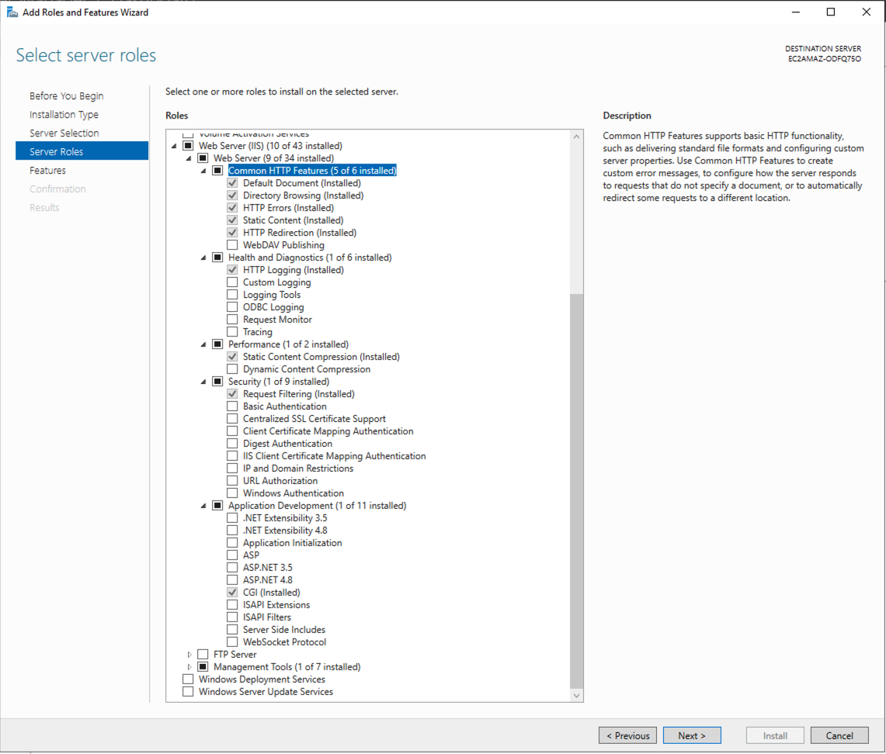

# Windows Installation

This page contains installation instructions for Windows.

## Prerequisites Checklist

Before starting the installation, confirm all of the following are in place:

- [ ] **Windows Server 2019, 2022, or 2025** (64-bit) — or Windows 10/11 for local development. This guide does not cover 32-bit environments. See [Windows Server 2025 notes](#windows-server-2025-notes) for what differs on 2025.
- [ ] **IIS 10+ with CGI feature enabled** — the CGI role is required for PHP FastCGI. Enable it with:
  ```powershell
  Enable-WindowsOptionalFeature -Online -FeatureName IIS-CGI
  ```
- [ ] **PHP 8.3 or later** — use the **Non-Thread-Safe (NTS)** build for IIS/FastCGI deployments. Download from [windows.php.net](https://windows.php.net/download/).
- [ ] **Composer** — PHP dependency manager. Download the installer from [getcomposer.org](https://getcomposer.org/Composer-Setup.exe).
- [ ] **Git for Windows** — required to clone the DreamFactory repository. Download from [git-scm.com](https://git-scm.com/download/win).
- [ ] **Visual C++ 2015–2022 Redistributable (x64)** — required by PHP and its extensions on Windows. Download from [Microsoft](https://aka.ms/vs/17/release/vc_redist.x64.exe). PHP 8.3 builds are compiled with Visual Studio 2019 (`vs16`) and PHP 8.4 with Visual Studio 2022 (`vs17`); both need this same 2015–2022 runtime.
- [ ] **URL Rewrite Module for IIS** — required for Laravel's routing. Download from [Microsoft](https://download.microsoft.com/download/1/2/8/128E2E22-C1B9-44A4-BE2A-5859ED1D4592/rewrite_amd64_en-US.msi).
- [ ] **Supported system database** — for the DreamFactory system database, use SQLite (default, easiest), MySQL 8.0+, PostgreSQL 13+, or SQL Server. SQLite requires no additional setup and is recommended for initial installation.
- [ ] **Local Administrator account** — IIS needs elevated permissions for directory access and FastCGI configuration.
- [ ] **DreamFactory license key** — required for Enterprise edition. Contact [DreamFactory support](https://www.dreamfactory.com/support/) if you do not have one.

 The server must not have any other IIS/web applications running on it in order to work with DreamFactory. You must be able to access the GUI of the server using something like RDP, have the ability to transfer files from your client machine to the server, and it is recommended to turn IE enhanced security **off** to make downloading some of the necessary installation files easier. Other applications might be able to run on the same IIS instance as DreamFactory, however this is not typically supported. 

A local Administrator account is also required at minimum for testing permissions, and possibly in perpetuity for IIS permissions.  

### Windows Server 2025 notes

The procedure on this page was verified on Windows Server 2025 (build 26100) with DreamFactory 7.7.1 and PHP 8.3.36 in November 2026: the scripted install, the site running as a local Administrator account and as the application pool identity, the SQL Server and Oracle driver steps, and PHP Manager 2.12. The steps are the same as for 2022; the differences are in the environment around them:

- **Internet Explorer is gone, but IE Enhanced Security Configuration is still there.** The Server Manager toggle (and the registry keys under `HKLM\SOFTWARE\Microsoft\Active Setup\Installed Components`) still exist and still block downloads in Edge until turned off.
- **`winget` is preinstalled**, so Git, the VC++ runtime, and other tools can be installed from an elevated prompt without a browser. Note that `winget` does not work when run as `SYSTEM` (for example from a cloud-provider run-command agent); use the direct installer links in this guide for unattended installs.
- **OpenSSH Server is built in** (service `sshd`, off by default). It is a convenient alternative to RDP for copying the composer files and running the command-line steps.
- **Cloud images:** on AWS the `Windows_Server-2025-*-Full-Base` AMIs ship the SSM Agent, so every step below can be run through Systems Manager Run Command with no inbound ports. SSM Agent builds before 3.3.1311.0 (November 2024) depended on `wmic.exe`, which Server 2025 no longer installs by default; current AMIs ship a fixed agent.
- **Resource sizing:** `composer install` for a commercial composer set took about 15 minutes on a 2 vCPU / 2 GB instance. Give the server at least 4 GB and 10 GB of free disk for a comfortable install.

## Server role setup

To start, set up the IIS Web server roles.

To enable the Web Server Roles:

1. Open the **Server Manager Application**.
2. Click on Option 2 **Add roles and features**.
3. Click **Next**.
4. Ensure that **Role based or feature based** is selected, and click **Next**.
5. Ensure the server you're working on is selected, click **Next**.
6. On server roles, check the **Web Server (IIS)** box, install any admin tools if asked, and click **Next**.
7. Your Web Server Role should look something like this (also outlined below): 

8. Click **Next** and then select **Install**. Let the installer run in the background, reup on coffee and start the download section below. 

### Web server roles
These are the web server roles DreamFactory recommends selecting:

- Web Server (IIS)
    - Common HTTP Features
        - Default Document
        - Directory Browsing
        - HTTP Errors
        - Static Content
        - HTTP Redirection
    - Health and Diagnostics
        - HTTP Logging
    - Performance
        - Static Content Compression
    - Security
        - Request Filtering
    - Application Development
        - CGI

## Downloads

There are a few installation files to download and, in some cases, installed. This section covers the downloads needed before starting the actual installation and configuration of the server. Getting all of these files on the server ahead of time ensures that the rest of the installation runs smoothly.

### DreamFactory specific files

Before starting, locate the following files on the server so they are ready to add to the installation when needed.

- Composer (license) files:
  - composer.json
  - composer.json-dist
  - composer.lock
- DreamFactory license key

:::note 
The composer files are typically grabbed from the DreamFactory SFTP server. Contact DreamFactory support if you need help accessing them. 
:::

### Git

The `git` command must be available to get the DreamFactory code later in the installation process. 

Git can be downloaded from [here](https://git-scm.com/download/win). Select the **64-bit Git for Windows Setup** version.

To install git, simply run the installer you downloaded and click **yes**/**next** on all default options. 

### Visual C++ 2015-2022

Download [here](https://aka.ms/vs/17/release/vc_redist.x64.exe)

Simply run the installer to install. If it reports that a newer version is already present, that is fine.

### URL rewrite module

Download [here](https://download.microsoft.com/download/1/2/8/128E2E22-C1B9-44A4-BE2A-5859ED1D4592/rewrite_amd64_en-US.msi)

Simply run the installer to install.

### PHP

PHP for Windows can be downloaded [here](https://windows.php.net/download#php-8.3). Be sure to get a 64-bit, **non-thread-safe (NTS)** version. Download the .zip file.

Use PHP 8.3.36 or a later 8.3 release. Earlier builds have the critical vulnerabilities described in the [PHP security advisory](/Security/php-cve-2026-109618-109619). Download the file named like `php-8.3.36-1-nts-Win32-vs16-x64.zip` (the `-1` is a rebuild number that newer Windows builds carry). Older releases are listed at [downloads.php.net/~windows/releases](https://downloads.php.net/~windows/releases/).

Just get the .zip downloaded. It is installed later in the process. 

### Composer

Composer is a package manager for PHP. The installer can be directly downloaded [here](https://getcomposer.org/Composer-Setup.exe).

Just get the installer downloaded. It is run later in the process. 

### PHP Manager

PHP Manager is an IIS utility to make managing PHP and extensions much easier. It is optional: every step below that uses it also lists the equivalent IIS Manager or `appcmd` action.

Download `PHPManagerForIIS_x64.msi` from the [PHP Manager 2 releases page on GitHub](https://github.com/phpmanager/phpmanager/releases/latest). The current release is 2.12 (March 2023).

:::warning
Do not use the older **PHP Manager 1.5.0 for IIS 10** listing on iis.net. Its **Download this extension** button no longer links to a file, so clicking it does nothing. The GitHub release above is the maintained successor and installs on IIS 10 on Windows Server 2019, 2022 and 2025.
:::

PHP Manager 2.12 predates PHP 8.3. Verified on Windows Server 2025 with PHP 8.3.36: the MSI installs, registers the **PHP** provider in IIS Manager, and recognizes a PHP 8.3 FastCGI handler that was registered by hand, both in the UI and through its PowerShell snap-in (`Add-PSSnapin PHPManagerSnapin; Get-PHPVersion`). Installing it does not change `php.ini`. Users report that its diagnostics flag 8.3 as obsolete, so treat **View Recommendations** as suggestions: the `php.ini` block on this page already contains the settings it would apply. It needs the IIS Management Console feature (`Web-Mgmt-Console`), which the role wizard installs when you accept the management tools.

Simply run the downloaded installer while IIS is closed to complete the install.

### SQL Server drivers

If you plan to use DreamFactory to connect to a SQL Server, you must have the driver packages. 

Start with downloading the v17 and v18 drivers:

- [Version 17](https://go.microsoft.com/fwlink/?linkid=2249004)
- [Version 18](https://go.microsoft.com/fwlink/?linkid=2249006)

Run **both** downloaded installers.

For the drivers to be used, you also need the sqlsrv PHP extensions. Start by going to the releases page [here](https://github.com/microsoft/msphpsql/releases).

Find the latest release and look in the assets section. Windows packages are at the end of the list. Download the `Windows_<version>RTW.zip` package; it contains the DLLs for every PHP version the release supports.

As of this writing (November 2026) the latest release is 5.13.3, which can be directly downloaded [here](https://github.com/microsoft/msphpsql/releases/download/v5.13.3/Windows_5.13.3RTW.zip). It ships DLLs for PHP 8.3 and 8.4.

## Getting DreamFactory running

The rest of the procedure involves two primary objectives: getting DreamFactory installed and running with the PHP development server, and then configuring IIS to serve DreamFactory. This section cover the installation and PHP development server set up. 

### Installing PHP

1. Create a new folder: `C:\php\`, grab the PHP installation .zip you gathered earlier, and extract the entire contents to the `C:\php\` folder. 

2. Duplicate (copy/paste) the `php.ini-development` file, and rename the duplicate `php.ini`.

:::note
You might need to enable file name extentions in the **View** tab of the file explorer.
:::

3. Open the newly created php.ini and copy/paste the following at the bottom of the file:

```ini
; Where PHP looks for extension DLLs. PHP's compiled-in default on Windows is C:\php\ext,
; so set this explicitly if PHP lives anywhere else.
extension_dir="C:\php\ext"

; Extensions required by DreamFactory
extension=ldap
extension=curl
extension=ffi
extension=ftp
extension=fileinfo
extension=gd
extension=intl
extension=mbstring
extension=exif
extension=mysqli
extension=odbc
extension=openssl
extension=pdo_mysql
extension=pdo_odbc
extension=pdo_pgsql
extension=pdo_sqlite
extension=pgsql
extension=shmop
extension=soap
extension=sockets
extension=sodium
extension=sqlite3
extension=tidy
extension=xsl
extension=zip

; OPcache — required for acceptable performance
zend_extension=opcache
opcache.enable=1
opcache.memory_consumption=256
opcache.interned_strings_buffer=16
opcache.max_accelerated_files=20000
opcache.revalidate_freq=0
opcache.validate_timestamps=1
opcache.enable_cli=0

; IIS FastCGI. php.ini-development says of cgi.force_redirect: "You CAN safely turn this off for IIS, in fact, you MUST."
cgi.force_redirect=0
cgi.fix_pathinfo=1
fastcgi.impersonate=1
fastcgi.logging=0

; Error logging (create the C:\php\logs folder)
log_errors=On
error_log="C:\php\logs\php_errors.log"

; DreamFactory recommended PHP settings
memory_limit=256M
max_execution_time=300
max_input_time=300
post_max_size=100M
upload_max_filesize=100M
display_errors=Off
display_startup_errors=Off
expose_php=Off
date.timezone=UTC
```

4. Save and close php.ini, then create the folder `C:\php\logs` so PHP can write its error log there.

:::warning
Keep `extension_dir` in step with where you extracted PHP. If it points at a folder that does not exist, every `extension=` line fails, and because the block above turns `display_startup_errors` off, the only evidence is a run of "Unable to load dynamic library" warnings in `php_errors.log`. `php -m` will list only the built-in modules.
:::

:::note
The `memory_limit` of 256M is a minimum. If you're running complex joins, large result sets, or heavy scripting workloads, increase to 512M.
:::

:::warning
Do not skip the OPcache tuning block. Running OPcache with default settings on a DreamFactory installation will result in degraded performance — DreamFactory's codebase exceeds the default `max_accelerated_files` limit of 10,000 files.
:::

:::note
You can manually add PHP to your enviornment variable path, however this is done automatically during the Composer installation. 
:::

### Installing Composer

To start, run the composer installer you downloaded earlier. 

You can select **Next** through most of the installation. When asked to browse to your command line/CLI PHP, navigate to: `C:\php\php.exe`. Then check the **Add to path** option. Click **Next** and wait. 

:::info
This is a great time to test both the PHP and Composer installations, open a new commmand prompt and run:

`php -v`

`composer --version`

If both of those commands are successful, you are safe to keep moving forward. 
:::

### Installing SQL Server drivers (optional)

This is an optional step dependent on if you intend to use DreamFactory with SQL Server. The [unattended installer script](#unattended-installation) performs it by default, installing ODBC Driver 17 and 18 and both extensions; pass `-SkipSqlServer` to leave them out.

The v17 and v18 drivers should have been installed during the previous steps, if not, install them now. 

Open the `Windows_5.13.3RTW.zip` downloaded earlier. Its `Windows` folder contains one DLL per PHP version, thread model, and architecture. Copy the **two** 64-bit NTS (Non Thread Safe) files for your PHP version, `php_sqlsrv_83_nts_x64.dll` and `php_pdo_sqlsrv_83_nts_x64.dll`, into your PHP ext folder (`C:\php\ext\`).

Then rename both files, removing the `_83_nts_x64` suffix, so they are named:

- php_pdo_sqlsrv.dll
- php_sqlsrv.dll

Finally, add the two extensions to the end of `php.ini`. They are deliberately not in the main extension block above, because PHP logs a startup warning on every request if they are listed but the DLLs are missing:

```ini
extension=php_sqlsrv.dll
extension=php_pdo_sqlsrv.dll
```

### Get (git) DreamFactory code

Next, get the DreamFactory code by opening a command prompt, and running:

`cd C:\inetpub\wwwroot\`

`git clone https://github.com/dreamfactorysoftware/dreamfactory`

This creates a `C:\inetpub\wwwroot\dreamfactory` folder on the server, refered to as the **DreamFactory installation folder** in this and other documentation.

### Install DreamFactory dependencies

DreamFactory uses Composer to handle all PHP dependencies, if you haven't installed Composer from the installation section above, do so now. 

First, take your 3 composer/license files (`composer.json`, `composer.json-dist`, `composer.lock`) and add them to the DreamFactory installation directory, overwriting the existing composer files in that directory. Then, open a command prompt, cd into the dreamfactory installation directory and run:

`composer install --no-dev --ignore-platform-reqs --verbose`

Sometimes this command takes a while to run, if it feels hung, hit enter a couple times in the command prompt. 

### Build DreamFactory system database and root admin

Once the composer install finishes, we can finalize the DreamFactory setup. In your command prompt, cd into the dreamfactory installation directory. Start by running: 
`php artisan df:env --df_install=Windows`.

This command defines the system database for the DreamFactory environment. For initial installation, it is recommended to start with option [0], Sqlite. If you run into problems during the installation, starting with sqlite eliminates database/networking issues from the troubleshooting process. This database can be changed at a later date, and any configurations you build in sqlite can be exported and imported into another instance later. 

When selecting a database name and user, it is recommended to stick with the default "dreamfactory" and "dfadmin" respectively. 

Once the df:env command finishes, run:
`php artisan df:setup`
This command prompts you to create your first admin user. This email and password are used to log in to the UI later. The root admin account details can be changed later.

:::warning[Scripted installs must pass the admin phone number]
`df:setup` accepts all of the admin details as options, which is how unattended installs run it:

```cmd
php artisan df:setup --admin_first_name=First --admin_last_name=Last --admin_email=admin@example.com --admin_password=AtLeast16Characters --admin_phone=000-000-0000 --no-interaction
```

The phone number is required. If `--admin_phone` is left out, the command prints `The phone field is required.` but still exits with code 0 and no admin user is created, so a script cannot tell that it failed. Check the output, or confirm the `user` table has a row, before moving on.
:::

Finally, add your license key to the end of the .env file located in the dreamfactory installation directory. You can add it to the bottom of the file like:
`DF_LICENSE_KEY={YOUR LICENSE KEY}`

:::note
Ensure that you remove the curly brackets seen in the example above.
:::

### Production .env settings

Before going live, set the following values in your `.env` file. The `.env` written by `df:env` sets `APP_ENV=local` and leaves `APP_DEBUG` and `APP_LOG_LEVEL` unset, which is fine for initial setup and testing but should be made explicit for any production or customer-facing deployment:

```env
APP_ENV=production
APP_DEBUG=false
APP_LOG_LEVEL=warning
```

| Setting | After `df:env` | Production Value | Why |
|---------|----------------|-----------------|-----|
| `APP_ENV` | `local` | `production` | Enables Laravel production optimizations |
| `APP_DEBUG` | not set (Laravel treats it as `false`) | `false` | Prevents stack traces from appearing in API error responses |
| `APP_LOG_LEVEL` | not set (defaults to `warning`) | `warning` | Prevents logs from flooding with routine request/response info |

:::danger
Setting `APP_DEBUG=true` in production means every PHP exception will return a full stack trace — including file paths, SQL queries, and environment details — to anyone calling your API. Change this before pointing any external traffic at the server.
:::

### Test DreamFactory

In order to run a test/development Laravel server, from the dreamfactory installation directory run:
`php artisan serve`

This starts a web server at http://127.0.0.1:8000. If you can navigate to this url, login to the UI with the root admin created earlier. If you **don't** have a red banner at the top of the UI, you have done everything correctly. If the red banner is still visible, go back and check for any steps you may have missed before moving forward. 

From here, DreamFactory is installed, the next section focuses on getting IIS to serve DreamFactory on port 80.

## Serving DreamFactory with IIS

This section highlights the IIS configuration needed to serve DreamFactory. 

:::note
We at DreamFactory are not Windows experts. The guidance provided here outlines a basic, default IIS configuration that has been tested and is known to work with DreamFactory on Windows environments. This setup is intended as a foundation for your DreamFactory installation. It's important to understand that while this configuration works for us and is supported by our team, Windows and IIS are versatile platforms. As such, there may be alternative configurations that also work well, depending on your specific needs and environment. We encourage you to use this as a guide, but feel free to explore and implement what works best for your situation.
:::

To begin, open the IIS manager, most of the steps here take place in the IIS manager. 

### Create DreamFactory site

In the left panel of the IIS manager UI, open **sites**, right click, and select **remove the default site**.

Next, right click on the **sites** folder and select **Add Website**. Then fill in the dialog:

- Site name: typically set to "dreamfactory" but can be whatever you'd like
- Physical Path: `{dreamfactory install dir}/public` if you've been following along this should be: `C:\inetpub\wwwroot\dreamfactory\public\`
- Application pool: use a dedicated pool with **.NET CLR version** set to **No Managed Code**
- Connect as...
  - For the default DreamFactory configuration, the "Connect As" should be set to a **local server Administrator account** set under the **Specific User** option. With `fastcgi.impersonate=1` (set in the `php.ini` block above) PHP then runs as that account, which is why no folder permissions need to be granted for this path. Other options such as domain users can be used, however you might run into permission issues that will need to be solved. DreamFactory support is able to support the local Administrator account, but is unable to help with setting domain/non-local admin account permissions. 
  - Use the "Test Settings" button, and ensure you have two green check marks. 

:::note
Due to the vast diversity in Windows environments, initial testing of DreamFactory necessitates the use of the local Administrator account. If DreamFactory is accessible with the local Administrator account but encounters issues with domain or non-admin user accounts, the problem often stems from permissions issues. We strongly recommend and support the use of the local Administrator account. Troubleshooting permission issues is often required for non-admin accounts to resolve access discrepancies.
:::

:::info[Alternative: run the site as the application pool identity]
If you cannot store an Administrator password in IIS (unattended installs, hardened servers), the site can run under its application pool identity instead. Both identities were verified on Windows Server 2025:

1. Leave **Connect as** on **Application user (pass-through authentication)**.
2. In the site's **Authentication** feature, edit **Anonymous Authentication** and choose **Application pool identity**. By default IIS uses the `IUSR` account for anonymous requests, and `IUSR` is **not** a member of `IIS_IUSRS`, so PHP fails with `file_put_contents(...storage\framework/cache/...)` errors until this is changed.
3. Grant `IIS_IUSRS` Full control on the folders listed under [Directory permissions](#directory-permissions), including `database`.
:::

### Handler mappings

Handler mappings tell IIS how/where to use the php executables in serving DreamFactory. Select the server on the left side of the IIS manager and click on the **Handler Mappings** icon. To create a new mapping, on the right side of the page, click **Add Module Mapping**. 

Fill in the **Add Module Mapping** dialog:

- Request Path: `*.php`
- Module: `FastCgiModule`
- Executable: `C:\php\php-cgi.exe`
- Name: `PHP_via_FastCGI`

Next, click on request restricions, and ensure the following are set:

- Mapping: file or folder
- Verbs: all
- Access: script

Click **OK** to save the handler mapping. 

### PHP manager config

If you skipped PHP Manager, you can skip this section too: the `php.ini` block earlier on this page already contains the settings that its recommendations apply (`cgi.force_redirect=0`, `cgi.fix_pathinfo=1`, `fastcgi.impersonate=1`, `fastcgi.logging=0`, `date.timezone`, and an `error_log` path). Confirm PHP works by browsing to a `phpinfo()` file in the site's `public` folder instead.

Again, from the server view on the left, click on the **PHP Manager** icon. 

Generally a yellow notice that your PHP configuration is non optimal is displayed. Click on **View Recommendations**, check the boxes and apply every available recommendation.

Test that PHP is working, click the **Check phpinfo()** link and then test using the DreamFactory site. Ensure that you see a purple and white PHP info output in this screen. If not, go back and resolve any PHP installation issues. 

If your php.ini is built correctly you should be able to access **Enable or disable an extension** and see them enabled. You can also enable extensions manually in the PHP Manager which applies the appropriate edits to the `php.ini` file.

### FastCGI settings

There are a few setting changes to make to the default FastCGI configuration.

From the server view, select **FastCGI Settings**, then select the handler you made earlier and click **Edit...**.

Make the following changes:

| Setting | Value | Why |
|---------|-------|-----|
| **Standard Error Mode** | `IgnoreAndReturn200` | Prevents PHP stderr from generating IIS 500 errors |
| **Activity Timeout** | `120` | Gives PHP scripts enough time to complete |
| **Request Timeout** | `300` | Must be ≥ `max_execution_time` in php.ini |
| **Max Instances** | `20` | Allows concurrent requests; increase for high-traffic installs |

Click **OK** to save.

:::warning
The **Standard Error Mode** change is required. Leaving it at the default `ReturnStdErrIn500` will cause DreamFactory to return 500 errors for normal PHP warnings and notices.
:::

### Application Pool tuning

From the IIS Manager left panel, click **Application Pools**, select the DreamFactory pool, and click **Advanced Settings** on the right.

Make the following changes:

| Setting | Value | Why |
|---------|-------|-----|
| **Start Mode** | `AlwaysRunning` | Eliminates cold-start latency after app pool recycles |
| **Idle Time-out (minutes)** | `0` | Prevents IIS from suspending the pool between requests |

Click **OK** to save, then recycle the app pool.

### Default document

Select the DreamFactory site, open **Default Document**, click **Add...**, enter `index.php`, and move it to the top of the list. Without this, requesting the site root (`http://localhost/`) returns **HTTP 403.14** because the `web.config` that ships with DreamFactory contains the rewrite rules but does not declare a default document.

### Request filtering

From the server view, select the **Request Filtering** icon. Then Navigate to the **HTTP Verbs** tab. On the right side, click **Allow Verb** and add the following verbs one at a time:

- GET
- HEAD
- POST
- DELETE
- PUT
- PATCH

This step is required: the `web.config` in the DreamFactory `public` folder does not allow these verbs itself. If PUT, PATCH, or DELETE calls return **HTTP 405**, this is the step that was missed. The same change from an elevated command prompt:

```cmd
%windir%\System32\inetsrv\appcmd.exe set config /section:requestFiltering /+verbs.[verb='PUT',allowed='true']
%windir%\System32\inetsrv\appcmd.exe set config /section:requestFiltering /+verbs.[verb='PATCH',allowed='true']
%windir%\System32\inetsrv\appcmd.exe set config /section:requestFiltering /+verbs.[verb='DELETE',allowed='true']
```

### URL rewrite rules

The DreamFactory repository ships a `public\web.config` that already contains the rewrite rules, so on a fresh clone there is usually nothing to import: once the URL Rewrite module is installed, `http://localhost/` should answer with a 302 redirect to `/dreamfactory/dist/index.html`. Import the rules manually only if `web.config` is missing or has been replaced.

On the left side of the IIS management window, open the DreamFactory site, and select the **URL Rewrite** module. To import the URL rewrite rules:

1. on the right side of the page, click **Import Rules**. 
2. Browse to the dreamfactory/public dir and open **.htaccess**.
3. Click **Import**.
4. If any of the imported rules have red **X**s on them, select them and remove that specific rule until everything shows a green checkmark. 
5. Click **Apply** to complete the process. 

### Directory permissions

IIS needs control over certian folders within the DreamFactory installation directory in order to function properly. Right click and select **Properties** on the following folders and give IIS_IUSRS full control over them. Additionally, be sure to unckeck the **read only** option, and apply all changes recursively if asked:

- `storage`
- `bootstrap/cache`
- `public`
- `database` — only when the system database is SQLite. DreamFactory 7 stores it as `database\database.sqlite`, and SQLite also needs to create journal files next to it. Without write access on this folder the UI loads but logging in fails with HTTP 500.

:::note
Sometimes these permisions don't set correctly with the properties window. If you are having permissions issues, we have seen good results by running these commands from the DreamFactory install directory:

`icacls "bootstrap\cache" /grant "IIS_IUSRS:(OI)(CI)F" /T`

`icacls "storage" /grant "IIS_IUSRS:(OI)(CI)F" /T`

`icacls "database" /grant "IIS_IUSRS:(OI)(CI)F" /T`

:::

### Accessing DreamFactory

After completing the setup, you can navigate to the server's IP address or hostname to view the DreamFactory login screen on port 80. On a cloud instance, also open TCP port 80 in the provider's security group or firewall; the Windows Firewall rule for HTTP is enabled automatically when the IIS role is installed. At this stage, DreamFactory is operational. However, implementing SSL and creating a DNS entry for the server are some of the many additional configuration options at your disposal. Due to the extensive variety of configurations possible beyond this point, this guide does not cover them in detail. For more advanced IIS configuration, consult Microsoft's documentation as needed.

## Post-Installation Configuration

### Scheduled task (required for DreamFactory scheduler)

DreamFactory includes a built-in task scheduler for running scripts, reports, and maintenance on a schedule. For it to work, Windows Task Scheduler must call `php artisan schedule:run` every minute.

Open **Task Scheduler** and create a new task with the following settings:

- **Name:** `DreamFactory Scheduler`
- **Trigger:** Daily, repeat every **1 minute** indefinitely
- **Action:** Start a program
  - **Program:** `C:\php\php.exe`
  - **Arguments:** `artisan schedule:run`
  - **Start in:** `C:\inetpub\wwwroot\dreamfactory`
- **Run whether user is logged on or not:** checked
- **Run with highest privileges:** checked

:::note
Without this task, any scheduled scripts or workflows configured in the DreamFactory UI will never execute. There will be no error — they just won't run.
:::

### Node.js scripting on IIS — known issue

If you are using Node.js scripted APIs with `platform.api.post()` (or PUT/PATCH) for internal loopback calls, you must explicitly pass a `Content-Length` header. Without it, Node.js uses chunked transfer encoding, which IIS/FastCGI does not handle correctly on loopback connections — the request hangs until FastCGI's request timeout fires.

**This affects POST, PUT, and PATCH only. GET is not affected.**

Add `Content-Length` to every `platform.api.post()` call:

```javascript
const payload = JSON.stringify({ resource: [record] });

platform.api.post('myservice/_table/mytable', payload, {
    'Content-Type': 'application/json',
    'Content-Length': Buffer.byteLength(payload)  // required on IIS
}, function(result, response) {
    // handler
});
```

The same applies to `platform.api.put()` and `platform.api.patch()`.

### Scripting temp file cleanup

DreamFactory writes temporary files to `storage\scripting\` when executing Node.js scripts. These files are not automatically cleaned up. On a busy instance they will accumulate over time.

Add a second scheduled task to clean up files older than 1 day:

- **Name:** `DreamFactory Scripting Cleanup`
- **Trigger:** Daily at a low-traffic time (e.g. 2:00 AM)
- **Action:** Start a program
  - **Program:** `cmd.exe`
  - **Arguments:** `/c forfiles /p "C:\inetpub\wwwroot\dreamfactory\storage\scripting" /s /m *.js /d -1 /c "cmd /c del @path" 2>nul`

## Adding SSL

For details on adding SSL, DreamFactory recommends using [certbot](https://certbot.eff.org/instructions?ws=other&os=windows). Follow the instructions from the provided link to help you through the process. 

## Installing Oracle Driver
The process of installing Oracle drivers is a more manual process than with our Linux installers. To begin you will need to download 3 things:
- The Oracle "Basic" Instant Client package from [Oracle's Website](https://www.oracle.com/database/technologies/instant-client/winx64-64-downloads.html) (Example file instantclient-basic-windows.x64-23.7.0.25.01.zip)
- The Oracle "SDK" Instant Client Package from [Oracle's Website](https://www.oracle.com/database/technologies/instant-client/winx64-64-downloads.html) (Example file instantclient-sdk-windows.x64-23.7.0.25.01.zip)
- The PHP oci8 extension (DLL) available at [Pecl PHP Site](https://pecl.php.net/package/oci8) By default, DreamFactory runs on PHP 8.3 so you will want the x64 NTS package for PHP 8.3 (version 3.4.0 is the first oci8 release with PHP 8.3 DLLs). If you are running DreamFactory using IIS as your webserver you must be using the non thread safe version of PHP.


- `Note you will want to click on the DLL button under downloads on the Pecl site for windows .dll files`
- `Unless you have good reason, choose the appropriate DLLs with the NTS tag`

- Next you will create a folder where the Oracle drivers will be kept, for example `C:\oracledrivers` and extract the Oracle "Basic" Instant Client there. The files will be extracted into a subdirectory called `instantclient_<version>.` Example:

`C:\oracledrivers\instantclient23_7`

- Next we will extract the "SDK" Instant Client to the same folder i.e. `C:\oracledrivers`. We want the SDK package to extract into the same subdirectory as in the previous step, not a new folder. Your driver folder should look like this:


- and the subdirectory should look like:


- Note that there is now an `SDK` folder inside.

Next, we need to add the full path of the Instant Client to the environment variables OCI_LIB64 and PATH. The quickest way to get to Environment Variables is to use the windows search bar and search for "environment" click on Environment Variables and then:

1. Under System Variables, create OCI_LIB64 if it does not already exist. Set the value of OCI_LIB64 to the full path of the location of Instant Client.


2.Under System Variables, edit PATH to include the same (C:\oracledrivers\instantclient_23_7)

`When utilizing the IIS web server, it is essential to include a new variable PATH in your FastCGI environment.`

`For example, a new variable could be: %PATH%;C:\oracledrivers\instantclient_23_7.`

The fastCGI path is located in the IIS Manager > Your Server > fastCGI Settings > Full Path > Edit > 3 dots next to collections


Almost there! Now, the last thing to do is to extract our PHP OCI8 extension package (it will be named along the lines of `php_oci8-3.4.0-8.3-nts-vs16-x64.zip`). The DLL inside is named `php_oci8_19.dll` (built against the Instant Client 19 interface, which newer clients still provide). Move it to the ext directory where PHP is located on your system (`C:\php\ext` if you followed this guide), add `extension=php_oci8_19.dll` to your php.ini file, and restart IIS. Verify with `php -m` (it should list `oci8`) and `php -r "echo oci_client_version();"`, which prints the Instant Client version, `23.7.0.25.1` for the packages above. If `oci8` is missing from `php -m`, the Instant Client folder is not on `PATH` for that process; the extension then fails to load with only a line in `php_errors.log`. Congratulations!


## MCP Daemon

If you plan to use the MCP Service, you must also run the background daemon server. This can be done using the provided PowerShell script:

```
cd {dreamfactory path}\vendor\dreamfactory\df-mcp-server\scripts
.\start-daemon-win.ps1
```

The script will automatically:
- Install all required npm dependencies.
- Start the daemon in the background using npx tsx.
- Use default host 127.0.0.1 and port 8006, unless overridden via environment variables:
  - MCP_DAEMON_HOST — host to bind the daemon (default: 127.0.0.1)
  - MCP_DAEMON_PORT — port to bind the daemon (default: 8006)
  - NODE_ENV — Node environment (default: production)

After starting, you can verify the daemon is running by checking its health endpoint:
```
Invoke-WebRequest -Uri http://127.0.0.1:8006/health -UseBasicParsing
```

## Unattended installation

Every step on this page has a command-line equivalent, which makes a fully scripted install possible. A reference PowerShell script, `install-dreamfactory-win.ps1`, lives alongside the Linux installers in the [`installers` folder of the DreamFactory repository](https://github.com/dreamfactorysoftware/dreamfactory/tree/master/installers). It performs the whole procedure (IIS role, Git, VC++ runtime, URL Rewrite, PHP, SQL Server drivers, Composer, DreamFactory, IIS site, and a verification pass) in idempotent phases and was used to validate this guide on Windows Server 2025. It is a starting point for automation, not a supported installer; read it before running it.

### Running the script

1. On a fresh server, open an elevated PowerShell prompt and download the script. A file saved through a browser carries the mark of the web, so unblock it or the default execution policy refuses to run it:

```powershell
Set-ExecutionPolicy -Scope Process Bypass -Force
New-Item -ItemType Directory -Force C:\df-install | Out-Null
Invoke-WebRequest -UseBasicParsing -Uri https://raw.githubusercontent.com/dreamfactorysoftware/dreamfactory/master/installers/install-dreamfactory-win.ps1 -OutFile C:\df-install\install-dreamfactory-win.ps1
Unblock-File C:\df-install\install-dreamfactory-win.ps1
Get-Help C:\df-install\install-dreamfactory-win.ps1 -Full
```

2. Open source install. `-DfRef` is the git tag or branch to check out; leave it off for the default branch. The system database defaults to SQLite; `-DbConnection mysql`, `pgsql` or `sqlsrv` together with the `-Db*` parameters uses an existing database server instead.

```powershell
C:\df-install\install-dreamfactory-win.ps1 -DfRef 7.7.1 `
  -AdminFirst Jane -AdminLast Doe -AdminEmail admin@example.com -AdminPassword 'AtLeast16Characters' -AdminPhone 000-000-0000
```

3. Commercial install. Put the `composer.json`, `composer-dist.json` and `composer.lock` from your commercial package in a folder and add these parameters to the command above. Add `-GithubToken` if Composer needs to authenticate to private repositories; the token reaches Composer only through the `COMPOSER_AUTH` environment variable.

```powershell
  -ComposerFilesDir C:\df-install\commercial -LicenseKey YOUR_KEY
```

The script can also run through a cloud run-command agent such as AWS Systems Manager, which runs it as `SYSTEM`.

### What to expect during the run

- Output stops for several minutes right after the `== Prep` line while `Install-WindowsFeature` adds the IIS role. Nothing is printed until it returns. The PHP download and `composer install` are the other long quiet stretches.
- If the `IIS features:` line reports `restart=True`, reboot and run the script again. Finished phases are skipped.
- `'crontab' is not recognized` lines during the DreamFactory phase are the [scheduler noise](#crontab-is-not-recognized-when-running-artisan-commands) described under Troubleshooting.
- A successful run ends with `VERIFY OK`. Everything is also written to `C:\df-install\install.log`. `AdminPassword`, `LicenseKey` and `GithubToken` are never echoed or logged.
- Afterwards `http://localhost/` redirects to the admin UI and the account you gave can log in.

### Re-running a phase

Each phase (`Prep`, `Php`, `SqlServer`, `Composer`, `DreamFactory`, `Iis`, `Verify`) writes a marker in `C:\df-install\state\` and is skipped on the next run. `-Phase <name>` runs a single phase; delete its marker first to make it redo the work:

```powershell
Remove-Item C:\df-install\state\Iis.done
C:\df-install\install-dreamfactory-win.ps1 -Phase Iis
```

Where the script deviates from the manual procedure above: it runs the site under the application pool identity rather than the Administrator account (see the note under [Create DreamFactory site](#create-dreamfactory-site)), registers the FastCGI handler with `appcmd` instead of PHP Manager, and verifies the result by requesting `/`, `/api/v2/system/environment`, logging in, and sending a PUT through IIS.

## Troubleshooting Common Windows Installation Issues

### HTTP 403.14 when opening the site root

**Error**: `HTTP Error 403.14 - Forbidden` for `http://localhost/`, while `http://localhost/index.php` works.

**Cause**: `index.php` is not in the site's default document list. The `web.config` shipped with DreamFactory does not add it.

**Fix**: See [Default document](#default-document).

### 500 with `file_put_contents(...storage\framework/cache/...)` in the response

**Error**: Every request returns HTTP 500 with a JSON error mentioning `storage\framework/cache/data/...: Failed to open stream`.

**Cause**: PHP is running as the anonymous `IUSR` account, which has no write access to `storage`. This happens when the site uses pass-through authentication and Anonymous Authentication is left on its default user.

**Fix**: Either set **Connect as** to the local Administrator account as described above, or switch Anonymous Authentication to **Application pool identity** and grant `IIS_IUSRS` on the folders under [Directory permissions](#directory-permissions).

### UI loads but login returns 500 (SQLite system database)

**Cause**: The `database` folder is read-only for the web server. SQLite needs to write both `database.sqlite` and its journal file.

**Fix**: `icacls "database" /grant "IIS_IUSRS:(OI)(CI)F" /T` from the DreamFactory installation directory, then `iisreset`.

### `df:setup` says "The phone field is required." and creates no admin

**Cause**: `df:setup` was run with `--admin_email` and `--admin_password` but without `--admin_phone`. The command reports the validation error and exits 0.

**Fix**: Re-run `df:setup` with `--admin_phone` added (any value such as `000-000-0000` works). The migrations and seeders are safe to re-run.


### `'crontab' is not recognized` when running artisan commands

**Error**: Every `php artisan` command (including `df:env` and `df:setup`) prints:
```
The system cannot find the path specified.
'crontab' is not recognized as an internal or external command,
operable program or batch file.
```

**Cause**: The df-scheduler package tries to install a Linux cron entry on every console run and has no Windows guard. The command it was asked to run still executes normally.

**Fix**: None needed. Ignore the lines; on Windows the scheduler is driven by the [Task Scheduler job](#scheduled-task-required-for-dreamfactory-scheduler) instead.

### 'Class not found' or autoload errors

**Error**: `Fatal error: Class 'DreamFactory\...' not found`

**Cause**: Composer dependencies have not been installed, or the autoloader is out of date.

**Fix**: Run Composer install from the DreamFactory installation directory:
```cmd
cd C:\inetpub\wwwroot\dreamfactory
composer install --no-dev --ignore-platform-reqs
```
If you have already run `composer install` and the error persists, try regenerating the autoloader:
```cmd
composer dump-autoload
```

### IIS 500.19 — Configuration error

**Error**: `HTTP Error 500.19 - The requested page cannot be accessed because the related configuration data for the page is invalid.`

**Cause**: IIS cannot read the `web.config` file, usually due to a missing URL Rewrite module or incorrect file permissions on `applicationHost.config`.

**Fix**: Confirm the [URL Rewrite module](https://download.microsoft.com/download/1/2/8/128E2E22-C1B9-44A4-BE2A-5859ED1D4592/rewrite_amd64_en-US.msi) is installed (restart IIS after installation). If the module is installed, check that the `IIS_IUSRS` group has Read permissions on the `C:\inetpub\wwwroot\dreamfactory\public` directory.

### PHP extension load failures — missing VC++ redistributable

**Error**: `PHP Startup: Unable to load dynamic library 'curl'` or similar extension load error in PHP logs.

**Cause**: PHP extensions on Windows depend on the Visual C++ runtime. If the correct VC++ redistributable version is not installed, extensions silently fail to load. The same error for *every* extension, with `(tried: C:\php\ext\...)` in the message while PHP is installed elsewhere, means `extension_dir` is wrong: PHP's compiled-in default is `C:\php\ext`.

**Fix**: If the paths in the warning do not match your PHP folder, set `extension_dir` in `php.ini` (see [Installing PHP](#installing-php)). Otherwise download and install the [Visual C++ 2015–2022 Redistributable (x64)](https://aka.ms/vs/17/release/vc_redist.x64.exe), then restart IIS:
```powershell
iisreset
```
Verify extensions load correctly by running:
```cmd
php -m
```
All extensions listed in `php.ini` should appear in the output. Missing extensions indicate a load failure — check the PHP error log at `C:\php\logs\php_errors.log`.

### 'php_sodium.dll not found' or sodium extension error

**Error**: `PHP Startup: Unable to load dynamic library 'sodium'`

**Cause**: PHP cannot find or load `ext\php_sodium.dll`. The usual reasons are a wrong or unset `extension_dir`, a DLL from a different PHP build (a Thread-Safe or 32-bit extension under an NTS x64 `php-cgi.exe`), or a missing dependency such as `libsodium.dll`, which ships in the PHP zip root and must stay next to `php-cgi.exe`.

**Fix**: Confirm you downloaded the NTS x64 version of PHP from [windows.php.net](https://windows.php.net/download/); the filename should contain `nts` (e.g., `php-8.3.x-nts-Win32-vs16-x64.zip`). Check that `php.ini` is the one IIS loads (compare `phpinfo()` with `php --ini`), that `extension_dir` points at `C:\php\ext`, and that the whole zip was extracted to `C:\php`, not just the `ext` folder.

### White screen or blank page after IIS setup

**Error**: Browser shows a blank white page with no error when accessing DreamFactory through IIS.

**Cause**: A PHP fatal error occurred and `display_errors` is `Off`, so nothing is rendered. The detail is in the PHP error log (`C:\php\logs\php_errors.log` if you used the `php.ini` block above) or in `storage\logs\dreamfactory.log`.

**Fix**: Read the log and fix the reported error (missing extension, unreadable `.env`, wrong permissions). If the log is empty, confirm `log_errors=On` and `error_log` are set and the log folder exists. Also confirm **FastCGI Settings** > PHP handler > **Standard Error Mode** is **IgnoreAndReturn200**, otherwise PHP warnings become IIS 500 pages.

### php artisan commands fail with database errors during setup

**Error**: `SQLSTATE[HY000] [2002] No connection could be made` or similar database error when running `php artisan df:env`.

**Fix**: For initial setup, select **SQLite** (option 0) when prompted by `php artisan df:env`. SQLite requires no external database server and eliminates network connectivity as a variable during troubleshooting. You can migrate to MySQL or PostgreSQL after confirming the base installation works.

## Verifying the Installation

Once IIS is configured and DreamFactory is running, verify the installation is functional:

**1. Check the site root and the system environment endpoint**

From the Windows server (or from a client that can reach the server), run:
```powershell
curl.exe -sI http://localhost/
Invoke-WebRequest -Uri http://localhost/api/v2/system/environment -UseBasicParsing
```
The first request should return HTTP 302 with a `Location` of `/dreamfactory/dist/index.html` (a 403.14 means the default document is missing). `curl.exe` is built into Windows Server 2019 and later; it is used here because Windows PowerShell's `Invoke-WebRequest` turns a 302 with `-MaximumRedirection 0` into the unhelpful error `Operation is not valid due to the current state of the object`. The second returns HTTP 200 with JSON containing DreamFactory version, PHP version, and platform information. A 500 error indicates a PHP or application configuration issue; check `C:\inetpub\wwwroot\dreamfactory\storage\logs\dreamfactory.log` for details.

**1b. Confirm write verbs reach PHP**

After logging in through the API, refresh the session with a PUT. An HTTP 405 here means the Request Filtering verbs step was skipped:
```powershell
$login = Invoke-RestMethod -Method Post -Uri http://localhost/api/v2/system/admin/session -ContentType application/json `
  -Body (@{ email = "admin@example.com"; password = "YourPassword" } | ConvertTo-Json)
Invoke-WebRequest -Method Put -Uri http://localhost/api/v2/system/admin/session `
  -Headers @{ "X-DreamFactory-Session-Token" = $login.session_token } -UseBasicParsing
```

**2. Access the admin UI**

Navigate to `http://localhost` (or the server's IP/hostname) in a browser. You should see the DreamFactory login screen. Log in using the admin credentials created during `php artisan df:setup`.

**3. Confirm no red banner**

After logging in, verify there is **no red banner** at the top of the admin UI. A red banner indicates a configuration issue — common causes include a missing or invalid license key, or a failed database connection. If a banner appears, check the `.env` file in the DreamFactory installation directory and confirm `DF_LICENSE_KEY` is set correctly (no curly braces).

**4. Create the admin user via CLI (if setup was skipped)**

If the login page reports an unknown user, no admin was created. Run `df:setup` again with the admin options; it only creates a user when none exists:
```cmd
cd C:\inetpub\wwwroot\dreamfactory
php artisan df:setup --admin_first_name=First --admin_last_name=Last --admin_email=admin@example.com --admin_password=AtLeast16Characters --admin_phone=000-000-0000 --no-interaction
```
If it answers `Your instance is already setup.`, an admin exists and the password must be reset through the admin UI by another administrator. There is no `df:create-admin-user` command.

**5. Make a test API call**

Once logged in, create a test database service (SQLite works with no external dependency). Then verify the generated API responds correctly:
```powershell
# Replace YOUR_API_KEY with a key generated in the admin UI
Invoke-WebRequest -Uri "http://localhost/api/v2/YOUR_SERVICE_NAME/_table" `
  -Headers @{"X-DreamFactory-Api-Key" = "YOUR_API_KEY"} `
  -UseBasicParsing
```
A 200 response with a JSON `resource` array confirms the API is working end-to-end.

For additional configuration options including SSL setup and DNS configuration, see the [DreamFactory configuration guide](/getting-started/dreamfactory-configuration/basic-configuration).